# ARTEX Architecture

This document describes the structure, runtime behavior, and interfaces among components of **ARTEX Global Edition** (`github.com/Autumn-27/artex`): an LLM multi-agent autonomous penetration-testing system with a Go backend, embedded Next.js frontend, and PostgreSQL dual-graph store.

> Scope: authorized lab / defensive research only. See [README.md](README.md) for legal notices and the [Defense & Detection Guide](docs/defense-en.md).

---

## 1. High-level overview

| Layer | Technology | Role |
|-------|------------|------|
| UI | Next.js 16 + React 19 (static export, `go:embed`) | Dashboard, tasks, assets, findings, chat, system config |
| API / orchestration | Go `net/http` (`server`) | REST `/api/*`, JWT auth, SSE, task/engine lifecycle |
| Agents | `agent` + [`norma`](https://github.com/Autumn-27/norma) SDK | Goals, planner, workers, main-agent (human-in-the-loop) |
| Persistence | PostgreSQL 16 (`db`) | Asset graph + per-task exploration graph + config |
| Side systems | `traffic`, `guard`/`intercept`, `enrich`, `llmpool`, `notify`, … | MITM recording, tool approval, DNS/HTTP enrich, LLM failover, alerts |

A single binary (`cmd/artex`) listens on `-addr` (default `127.0.0.1:8787`) for UI+API and optionally on `-proxy` (default `127.0.0.1:8788`) for the traffic-recording MITM proxy.

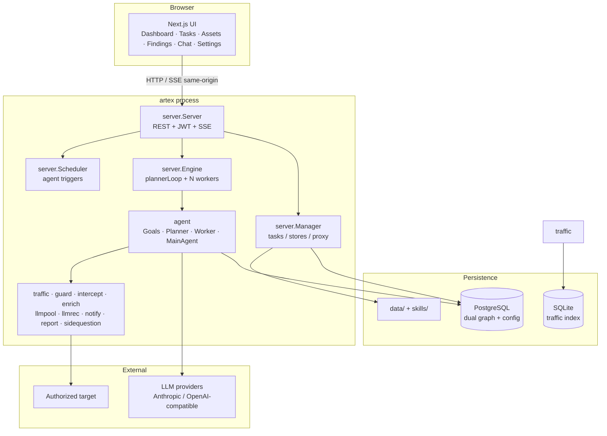

---

## 2. Repository structure

```
artex-global/
├── cmd/artex/          # Process entry: flags, Manager, HTTP serve, self-update exit codes
├── server/             # HTTP API, Manager, Engine, Scheduler, auth, SSE, webui embed
├── agent/              # LLM roles, ToolSet (dual-graph tools), prompts, compaction
├── db/                 # PostgreSQL access + schema.sql (go:embed, idempotent migrate)
├── config/             # Paths, env overrides, i18n for server messages
├── traffic/            # go-mitmproxy recording proxy + SQLite FTS index
├── guard/              # PreToolUse/PostToolUse hooks → intercept evaluation
├── intercept/          # DB-backed allow/deny/ask rules + human approval wait
├── enrich/             # Async DNS (dnsx) + HTTP probe → asset graph
├── llmpool/            # LLM provider failover / round-robin pool
├── llmrec/             # Optional LLM call recording
├── mcphttp/            # MCP HTTP/SSE client for external tools
├── notify/             # Channels: webhook, email, Telegram, DingTalk, Feishu, WeCom
├── report/             # Finding report assembly
├── sidequestion/       # Lightweight side Q&A (no tools, bounded context)
├── evidence/           # Traffic evidence snapshots for findings
├── selfupdate/         # Staged binary swap + rollback (exit 75 → start.sh relaunch)
├── web/                # Next.js frontend (build → server/webui/dist)
├── skills/             # Agent skill packs (api-recon, playwright-cli, scopesentry, …)
├── detections/         # Defensive Sigma / Suricata / ATT&CK / triage (not runtime)
└── docs/               # Defense guides, evidence docs
```

### Package dependency graph (first-party)

Arrows mean “imports”. `server` is the composition root; `cmd/artex` wires config + Manager + Server.

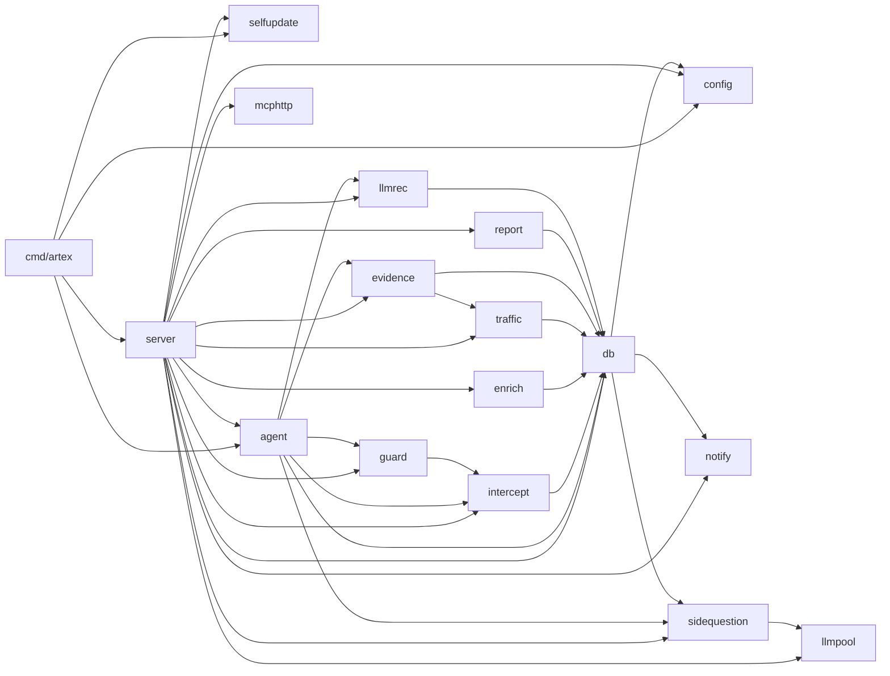

External SDK: almost all agent execution goes through **`github.com/Autumn-27/norma`** (`llm`, `tool`, `harness`, `agentcore`, `transcript`, `hook`, `permission`).

---

## 3. Component UML (logical)

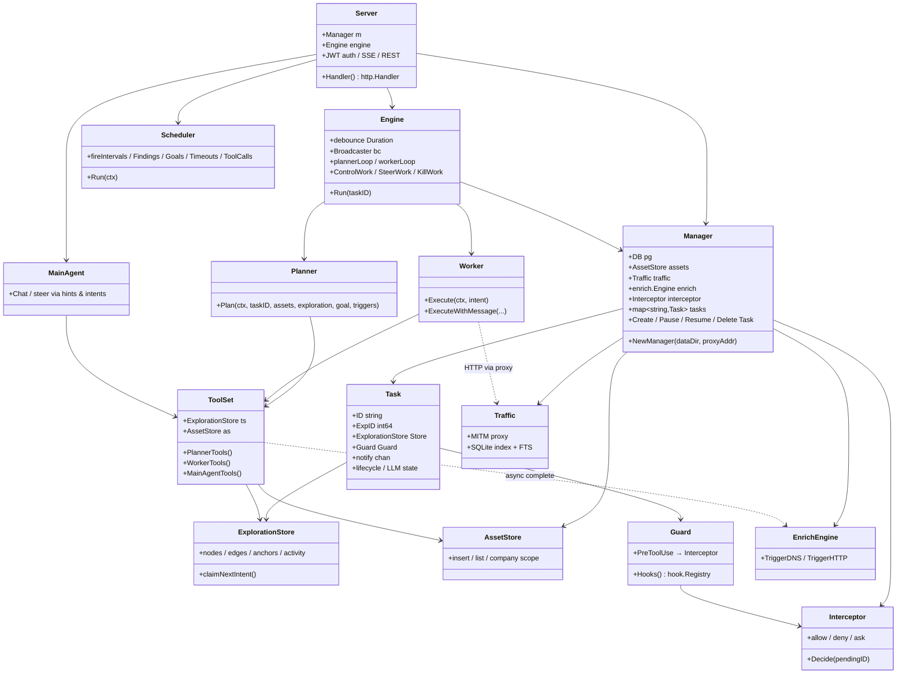

---

## 4. Dual-graph data model

The system separates **what the target is** (global asset graph) from **how far this task has explored** (per-task exploration graph). They join via **anchors**.

### 4.1 Conceptual UML

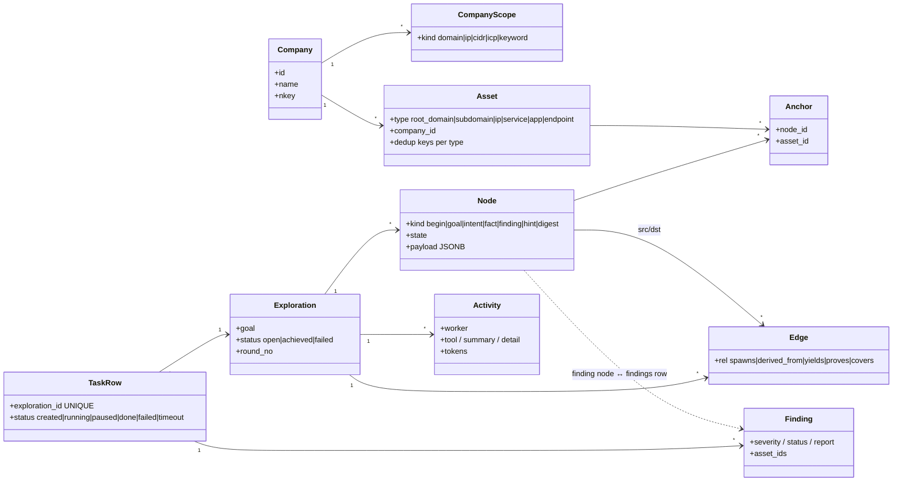

### 4.2 Graph relationship (runtime view)

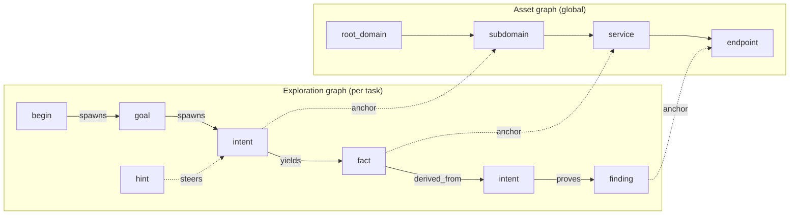

**Role split**

| Role | Writes | Does not |
|------|--------|----------|
| **Planner** | intents, prove/goal_met, kill/steer work | Execute tools against the target |
| **Worker** | facts, findings, assets (for one claimed intent) | Create the next attack-chain intent (planner’s job) |
| **MainAgent** | hints, intents, goals, constraints (human steer) | Own the autonomous planning loop |

---

## 5. Runtime behavior

### 5.1 Process bootstrap

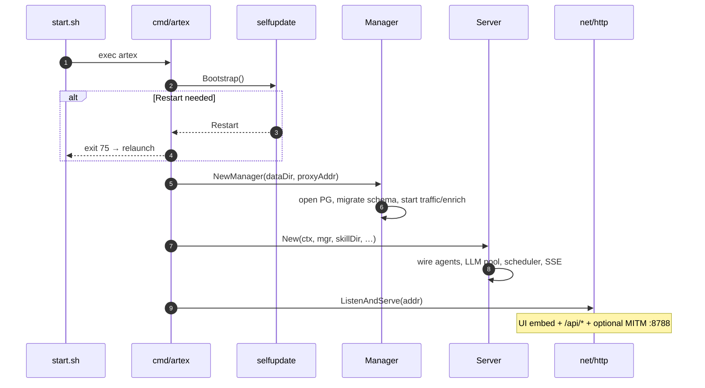

### 5.2 Closed exploration loop (engine)

Event-driven: graph change → debounced planner wake → intents on frontier → workers claim → write graphs → wake again until `prove_goal` / terminal task state.

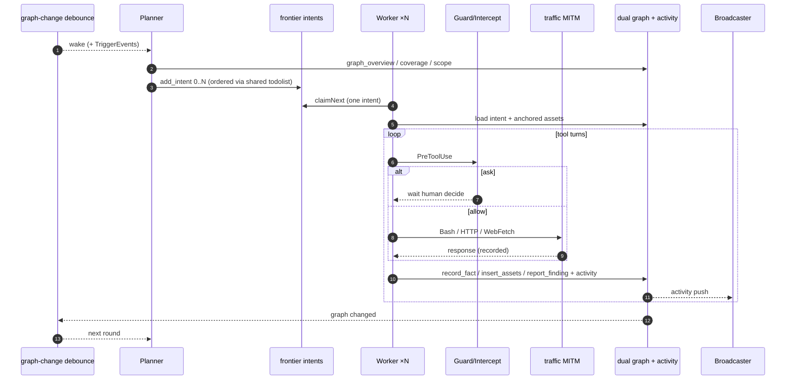

### 5.3 Shared planner todolist (multi-step attack chain)

Each planner wake is a **fresh LLM session**. A per-task **TodoStore** (norma) persists the ordered chain so rounds dispatch **one dependency-ready step at a time** instead of unfolding the whole chain in parallel.

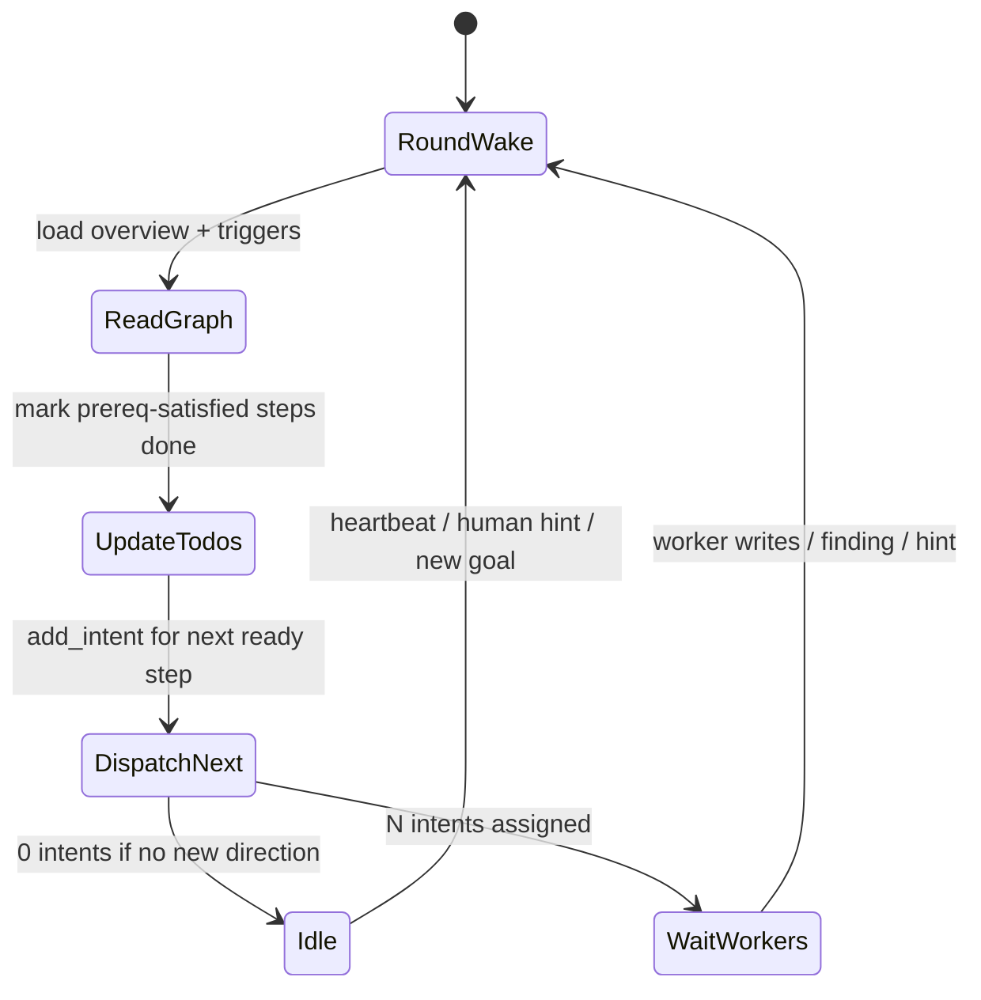

### 5.4 Worker cross-process information exchange

Workers do not share memory. They search **activity traces** of other workers in the same task:

1. `search_all_worker_traces(q)` — keyword search (excludes own steps)
2. `list_worker_traces` / `get_worker_trace(intent_id, step_ids)` — pull full step bodies

### 5.5 Human-in-the-loop paths

| Path | Component | Effect |
|------|-----------|--------|
| Chat | `MainAgent` + `/api/tasks/{id}/…` chat | hints → planner; high-priority intents → frontier; goals/constraints |
| Intent control | `Engine.ControlWork` | pause / resume / cancel one intent |
| Steer | `steer_work` | inject mid-run message before next tool call (no kill) |
| Intercept ask | `intercept` + UI approvals | block tool until allow/deny/timeout policy |
| Side question | `sidequestion` | read-only Q&A over captured context (no tools) |

---

## 6. Interfaces among components

### 6.1 HTTP API surface (server ↔ web)

`Server.Handler()` registers Go 1.22+ method patterns. Major groups:

| Prefix | Purpose |
|--------|---------|
| `/api/auth/*` | setup token, login, change password (JWT) |
| `/api/health`, `/api/stats`, `/api/logs*` | health, metrics, live logs |
| `/api/tasks*`, `/api/task-*` | CRUD, control, coverage, scope, goals, constraints, archives, templates |
| `/api/exploration/*` | frontier, findings, lineage, nodes, activity |
| `/api/assets`, `/api/companies` | global asset/company graph |
| `/api/llm*`, `/api/agents*`, `/api/mcp*`, `/api/skills*`, `/api/tools*` | LLM profiles, agent prompts, MCP, skills |
| `/api/intercept*`, `/api/workspace*`, `/api/traffic*` | approvals, workspace FS, traffic browser |
| `/api/notify*`, `/api/update*`, SSE streams | notifications, self-update, activity |

Frontend client: `web/src/lib/api.ts` (typed fetch; same-origin in production, proxied in `next dev`).

### 6.2 Agent ↔ DB (ToolSet)

`agent.ToolSet` is the primary **domain interface** from LLM tools to PostgreSQL:

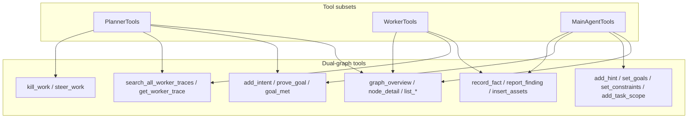

Callbacks on `ToolSet` close the loop back into `Engine` / UI:

- `notify` / `notifyFinding` / `notifyHint` / `notifyGoal` → wake planner with typed triggers  
- `resumeTask` → revive terminal/paused task after human adds goals  
- `killWork` / `steerWork` → engine per-intent control  
- `enrich` → `enrich.Engine` async DNS/HTTP completion  

### 6.3 Guard ↔ Intercept ↔ Human

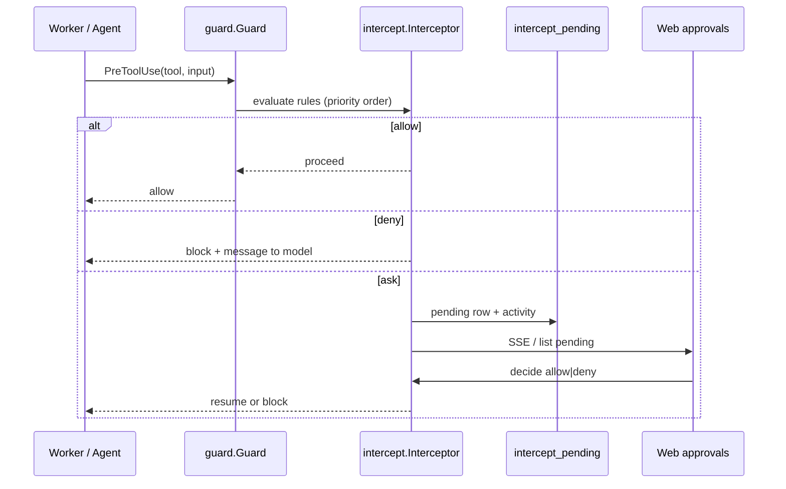

Rules live in `intercept_rules` / `task_intercept_rules` / `asset_intercept_rules`. Built-in destructive/exfil patterns are seeded as ordinary DB rules (user-disableable).

### 6.4 Traffic recording

- Agents’ Bash / WebFetch are pointed at the MITM (`Manager` / `SetProxy`).
- `traffic.Traffic` (go-mitmproxy) writes exchanges to a file tree + SQLite (+ optional FTS5).
- Findings can bind evidence via `finding_traffic_bindings` / `traffic_evidence_snapshots` (`evidence` package).

### 6.5 LLM provider stack

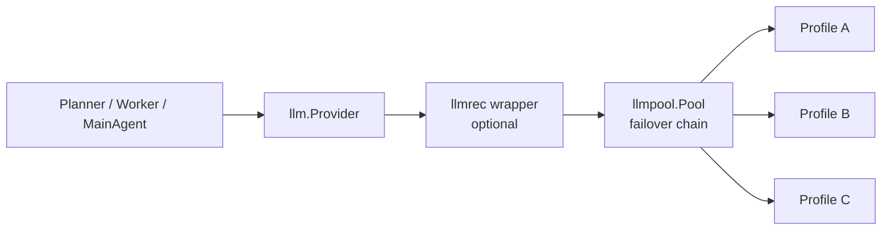

Profiles are rows in `llm_profiles`; health in `llm_profile_health`. Task-level chains override the global active profile (`task_llm_profiles`).

### 6.6 Scheduler ↔ agents

`server.Scheduler` polls DB `agent_triggers` and fires:

- interval timers  
- new findings / goal met  
- task timeout  
- task create  
- tool-call patterns  

Used for reporter agents, Auto orchestration bindings, and custom trigger→agent wiring (`server/assembly.go`, `orchestration.go`).

---

## 7. Frontend architecture

```
web/src/
├── app/
│   ├── (auth)/login|setup
│   ├── (main)/
│   │   ├── dashboard
│   │   ├── chat
│   │   ├── function/{tasks,assets,findings,traffic,workspace,commands,llm-records,sync}
│   │   └── system/{settings,llm,agents,mcp,skills,tools,intercept,notify,logs}
│   └── (external)/…
├── components/          # domain UI + shadcn/ui
├── lib/api.ts           # backend client
├── lib/types.ts         # DTOs aligned with Go handlers
├── i18n/ + messages/    # en · ko · zh · es · ja
├── hooks/ · stores/
└── navigation/
```

**Build path:** `npm run build:static` → `web/out` copied to `server/webui/dist` → compiled with `-tags embedui`. Without the tag (dev), API-only backend; UI runs on `:5173` via `dev.sh`.

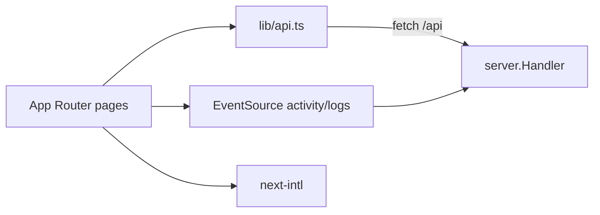

---

## 8. Deployment view

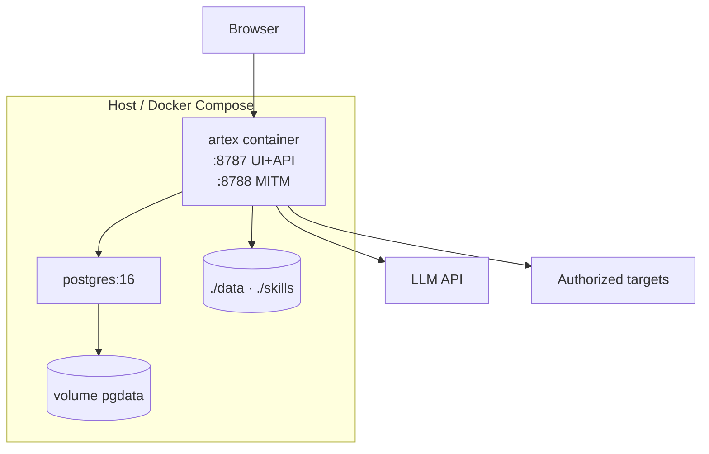

Supervisor scripts (`start.sh` / `start.bat`) relaunch on self-update exit code `75`. Reverse proxies must **disable buffering** for SSE.

---

## 9. Supporting & defensive packages

| Package / dir | Interface role |
|---------------|----------------|
| `notify` | Event → channel adapters (webhook/email/chat apps); used from DB/server on findings etc. |
| `report` | Assemble Markdown finding reports from DB |
| `mcphttp` | Connect external MCP tool servers into agent tool lists |
| `selfupdate` | GitHub release stage/swap/rollback |
| `skills/` | Filesystem skill packs mounted into agent work context |
| `detections/` | **Not loaded at runtime** — Sigma/Suricata/ATT&CK/indicators/triage for defenders studying ARTEX behavior |

---

## 10. Key behavioral invariants

1. **Planner is the only autonomous intent producer**; workers execute exactly one claimed intent then stop.  
2. **Asset graph is globally shared**; exploration graph is **per task**, linked by anchors.  
3. **Engine loops always run** but idle without an LLM provider; LLM can be configured at runtime from the UI.  
4. **Every tool call** can pass `guard` → `intercept` (allow / deny / ask).  
5. **Graph writes emit activity** → SSE to UI and debounced planner wakes.  
6. **Output language** for user-facing agent text is forced via `agent/prompt.go` (`langDirective`); internal reasoning prompts stay in the original language for performance.  
7. **Default bind is loopback**; first-run requires setup token (or `ARTEX_ADMIN_PASSWORD`).

---

## 11. Where to read next

| Concern | Primary code |
|---------|----------------|
| Entry / lifecycle | `cmd/artex/main.go`, `server/manager.go`, `server/engine.go` |
| HTTP routes | `server/server.go` (`Handler`) |
| Agent roles | `agent/planner.go`, `agent/worker.go`, `agent/mainagent.go`, `agent/goals.go` |
| Domain tools | `agent/tools.go`, `agent/tools_insert.go` |
| Schema | `db/schema.sql` |
| Product narrative | [README.md § System architecture](README.md#system-architecture) |
| Defender view | [docs/defense-en.md](docs/defense-en.md) |

---

*Generated from the repository source layout and package contracts. Diagrams use Mermaid (UML-style class, sequence, state, and deployment views) so they render in GitHub and most Markdown previews.*
