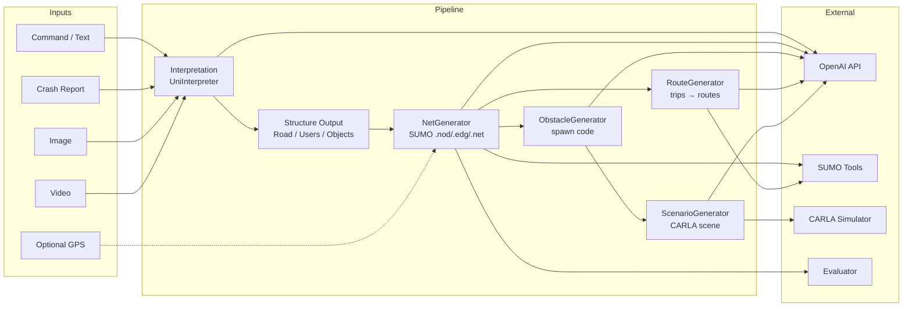
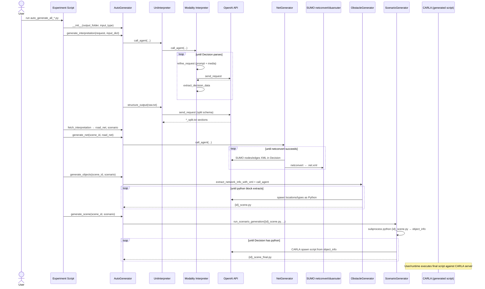
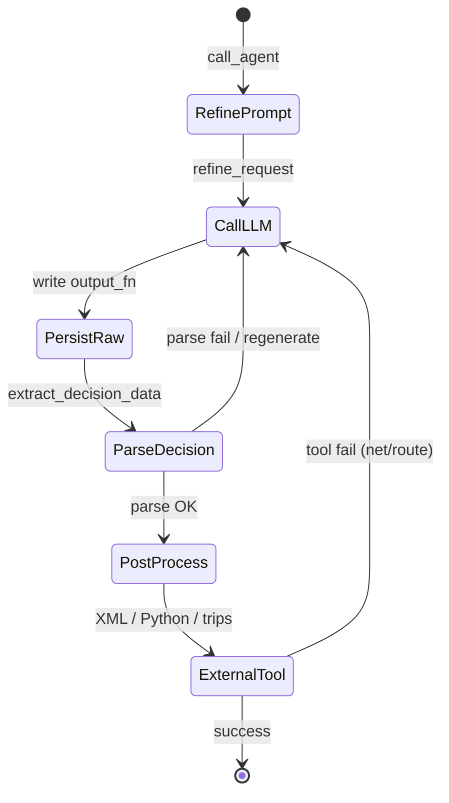
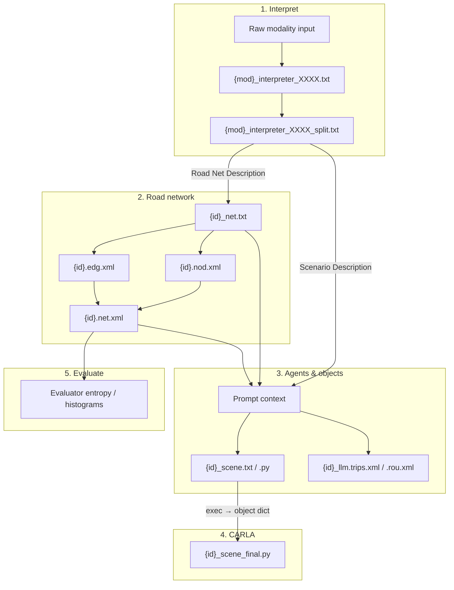
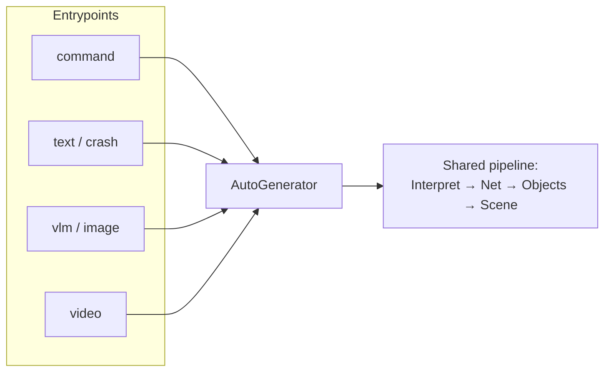
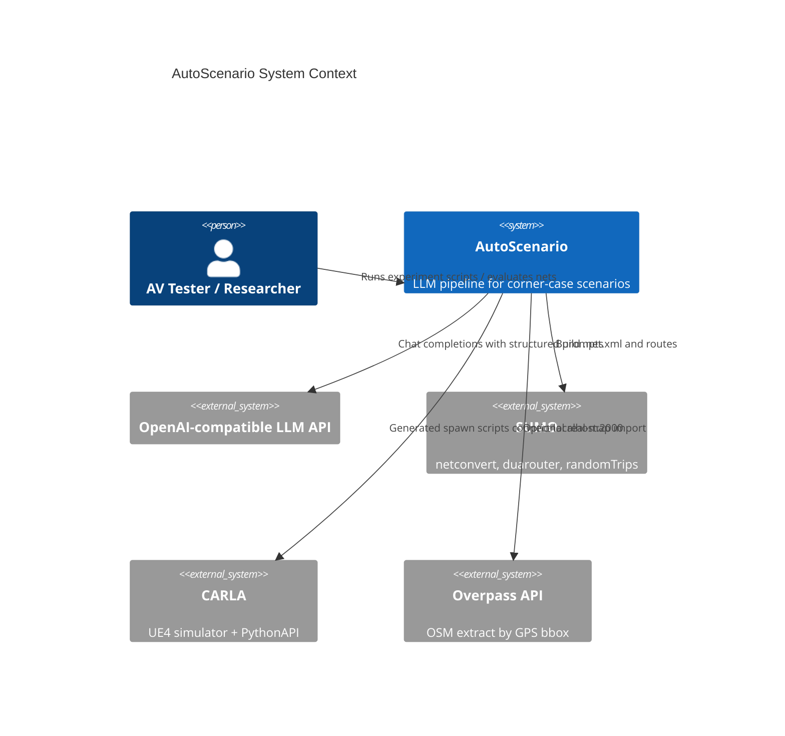

# AutoScenario Architecture

This document describes the structure, runtime behavior, and interfaces among components in **AutoScenario** — an LLM-driven framework that turns multimodal safety-critical data into executable AV test scenarios for **SUMO** and **CARLA**.

---

## 1. High-Level Overview

AutoScenario is a **pipeline-oriented multi-agent system**. Each major step is implemented as a `TaskAgent` subclass that:

1. Refines a domain-specific prompt (`refine_request`)
2. Calls an OpenAI-compatible chat API (`send_request`)
3. Parses a structured `## Decision` section from the model output
4. Optionally invokes external tools (SUMO `netconvert` / `duarouter`, CARLA Python API)



**End-to-end goal:** multimodal evidence → standardized scenario description → SUMO road network + agents/objects → CARLA spawn script → diversity metrics.

---

## 2. Repository Structure

```
AutoScenario/
├── agents/                     # Core LLM agents (generation + interpretation)
│   ├── task_agent.py           # Base class: API I/O
│   ├── universal_interpreter.py# Facade / strategy for input modalities
│   ├── command_interpreter.py  # Short command → scenario specs
│   ├── text_interpretor.py     # Crash report → scenario narrative
│   ├── vlm_interpreter.py      # Image → road/scene description
│   ├── video_interpreter.py    # Video frames → road/scene description
│   ├── net_generator.py        # Description → SUMO nodes/edges/net
│   ├── obstacle_generator.py   # Description + net → object spawn Python
│   ├── rou_generator.py        # Description + net → AV/BV routes
│   └── scenario_generator.py   # Object info → CARLA scene Python
├── experiments/                # Pipeline entrypoints (one per modality)
│   ├── auto_generate_all_command.py
│   ├── auto_generate_all_text.py
│   ├── auto_generate_all_vlm.py
│   └── auto_generate_all_video.py
├── tools/                      # Shared utilities + evaluation
│   ├── utils.py
│   ├── evaluation_metrics.py
│   └── general_evaluator.py
├── data/                       # Sample multimodal inputs
├── config.example              # → copy to .env (OpenAI settings)
├── requirements.txt
└── README.md
```

| Layer | Role |
|-------|------|
| `experiments/` | Orchestration (`AutoGenerator`); CLI entrypoints |
| `agents/` | Domain agents; prompt engineering; LLM parsing; SUMO/CARLA glue |
| `tools/` | File/XML helpers; entropy/angle metrics; batch evaluation |
| `data/` | Sample image / video / crash report |
| Config (`.env`) | `OPENAI_KEY`, `OPENAI_URL`, `OPENAI_MODEL`, tokens, timeout |

---

## 3. Component Architecture (UML Class Diagram)

```mermaid
classDiagram
    direction TB

    class TaskAgent {
        +post_header: dict
        +refine_request(user_request, add_info)*
        +send_request(user_request, add_info) str
    }

    class UniInterpreter {
        +pre_prompt: str
        +interpreter: TaskAgent
        +call_agent(user_request, input_info)
        +structure_output(raw_description_fn)
        +refine_request(user_request, add_info)
        +prepare_structurer_prompt(raw_fn)
    }

    class CommandInterpreter {
        +pre_prompt: str
        +call_agent(user_request, input_dict)
        +extract_decision_data(file_path)
        +task_summary(results)
    }

    class TextInterpreter {
        +pre_prompt: str
        +call_agent(user_request, input_dict)
        +extract_decision_data(file_path)
    }

    class VLMInterpreter {
        +pre_prompt: str
        +ImageEncode(image) str
        +call_agent(user_request, added_info)
        +extract_decision_data(file_path)
    }

    class VideoInterpreter {
        +pre_prompt: str
        +video_encode(video, sample_rate) list
        +call_agent(user_request, added_info)
        +extract_decision_data(file_path)
    }

    class NetGenerator {
        +save_dir: str
        +call_agent(user_request, scenario_id, add_info)
        +save_node_edge_files(save_dir, scenario_id, response)
        +generate_sumo_road_net(node_fn, edge_fn, net_fn)
        +prepare_net_based_on_gps(data_dir, scenario_id, gps_info)
        +generate_random_route(...)
    }

    class ObstacleGenerator {
        +call_agent(user_request, scenario_id, output_folder)
        +extract_network_info(...)
        +extract_network_info_with_xml(...)
        +extract_network_info_with_gps(...)
        +extract_decision_data(scenario_id, output_folder)
    }

    class RouteGenerator {
        +vehicle_data: list
        +call_agent(user_request, scenario_id, output_folder)
        +generate_trip_file(agents, filename)
        +convert_trip_to_route(net, trip, route)
        +generate_route_from_trips(...)
        +extract_decision_data(scenario_id, save_folder)
    }

    class ScenarioGenerator {
        +pre_prompt: str
        +run_scenario_generation(obj_code_fn, scenario_id, desc, out)
        +call_agent(user_request, scenario_id, output_folder, object_info)
        +extract_decision_data(scenario_id, output_folder)
    }

    class AutoGenerator {
        +interpreter: UniInterpreter
        +net_generator: NetGenerator
        +obstacle_generator: ObstacleGenerator
        +rou_generator: RouteGenerator
        +scenario_generator: ScenarioGenerator
        +output_folder: str
        +generate_interpretation(user_request, input_dict)
        +fetch_interpretation(input_dict)
        +generate_net(scene_id, road_net_description)
        +generate_objects(scene_id, scenario_description)
        +generate_routes(scene_id, scenario_description)
        +generate_scene(scene_id, scenario_description)
    }

    class Evaluator {
        +result_dir: str
        +output_dir: str
        +compute_states(save_fig)
    }

    TaskAgent <|-- UniInterpreter
    TaskAgent <|-- CommandInterpreter
    TaskAgent <|-- TextInterpreter
    TaskAgent <|-- VLMInterpreter
    TaskAgent <|-- VideoInterpreter
    TaskAgent <|-- NetGenerator
    TaskAgent <|-- ObstacleGenerator
    TaskAgent <|-- RouteGenerator
    TaskAgent <|-- ScenarioGenerator

    UniInterpreter o-- CommandInterpreter : input_type=command/request
    UniInterpreter o-- TextInterpreter : input_type=crash_report
    UniInterpreter o-- VLMInterpreter : input_type=image
    UniInterpreter o-- VideoInterpreter : input_type=video

    AutoGenerator *-- UniInterpreter
    AutoGenerator *-- NetGenerator
    AutoGenerator *-- ObstacleGenerator
    AutoGenerator *-- RouteGenerator
    AutoGenerator *-- ScenarioGenerator
```



### Design patterns in use

| Pattern | Where | Purpose |
|---------|--------|---------|
| **Template Method** | `TaskAgent.send_request` → `refine_request` | Shared API call; subclasses customize prompts |
| **Strategy** | `UniInterpreter` + modality interpreters | Swap interpretation by `input_type` |
| **Facade / Orchestrator** | `AutoGenerator` | Single pipeline API over many agents |
| **Retry loop** | Most `call_agent` methods | Re-query LLM until parse succeeds |

---

## 4. Interface Contracts

### 4.1 `TaskAgent` (base I/O contract)

```text
refine_request(user_request, add_info) -> str | list[multimodal_parts]
send_request(user_request, add_info)   -> str   # LLM message content
```

- `add_info` commonly includes:
  - `output_fn`: path to persist raw LLM response
  - modality keys: `image_path`, `video_path`, `text_path`, `frames`, `object_info`, `example`
- HTTP: `POST OPENAI_URL` with Bearer `OPENAI_KEY`, model / max_tokens / timeout from `.env`
- Response shape expected: `choices[0].message.content`

### 4.2 Interpretation agents → structured text

| Agent | Input (`add_info`) | Output artifact | Decision parse |
|-------|--------------------|-----------------|----------------|
| `CommandInterpreter` | `output_fn` | `*_interpreter_XXXX.txt` | List of `{road description, traffic density, test goal, lanes, vehicles}` |
| `TextInterpreter` | `text_path`, `output_fn` | same | Free-form decision narrative |
| `VLMInterpreter` | `image_path`, `output_fn` | same | Decision section (geometry-rich) |
| `VideoInterpreter` | `video_path`, `frames?`, `output_fn` | same | Decision section (+ sampled frames as base64) |

`UniInterpreter.structure_output` then rewrites the raw decision into a **split schema**:

```text
## Road Net Description:
## Road Users Description:
## Static Objects Description:
## Vehicles' Locations and Behaviors
## Scenario Description:
```

Persisted as `{prefix}_split.txt` (scene_id typically `{modality}_interpreter_{i:04d}_split`).

### 4.3 Generation agents → simulation artifacts

| Agent | Primary inputs | Outputs | External tool |
|-------|----------------|---------|---------------|
| `NetGenerator` | road-net text | `{id}.nod.xml`, `{id}.edg.xml`, `{id}.net.xml`, `{id}_net.txt` | `netconvert`; optional Overpass OSM |
| `ObstacleGenerator` | scenario text + net XML/txt | `{id}_scene.txt`, `{id}_scene.py` | (exec later by ScenarioGenerator) |
| `RouteGenerator` | scenario + net | `{id}_tripdata_raw.txt`, `{id}_llm.trips.xml`, `{id}_llm.rou.xml` | `duarouter` |
| `ScenarioGenerator` | scenario + object dict from running `{id}_scene.py` | `{id}_scene_final.txt`, `{id}_scene_final.py` | CARLA Python API (in generated code) |

### 4.4 `AutoGenerator` public orchestration API

```text
generate_interpretation(user_request, input_dict)  # interpret + structure
fetch_interpretation(input_dict) -> (road_net_desc, scenario_desc)
generate_net(scene_id, road_net_description)
generate_objects(scene_id, scenario_description)   # obstacles or routes
generate_routes(scene_id, scenario_description)    # command pipeline only
generate_scene(scene_id, scenario_description)     # CARLA final script
```

**Resume modes** (skip completed stages): `FullPipeline` | `AfterInterpreter` | `AfterNet` | `AfterObject`.

### 4.5 Evaluation interface

```text
Evaluator(result_dir, output_dir).compute_states(save_fig=False)
```

Consumes folders of `.net.xml` (+ matching `.nod.xml` / `.edg.xml`) and reports entropy / mean±std of lanes, edges, lengths, and intersection angles (`tools/evaluation_metrics.compute_connected_angles`).

---

## 5. Runtime Behavior

### 5.1 Full pipeline sequence



### 5.2 Per-agent request lifecycle



### 5.3 Data / artifact flow



---

## 6. Modality-Specific Entrypoints

All four experiment scripts share the same `AutoGenerator` skeleton; differences are `input_type` and `additional_info` keys.

| Script | `input_type` | Sample data | Extra `add_info` | Notes |
|--------|--------------|-------------|------------------|-------|
| `auto_generate_all_command.py` | `request` | inline string (+ optional GPS) | `GPS_info` | Also wires `RouteGenerator`; GPS path uses Overpass → OSM → SUMO |
| `auto_generate_all_text.py` | `crash_report` | `data/crash_report_02.txt` | `text_path` | Narrative crash reports |
| `auto_generate_all_vlm.py` | `image` | `data/0107.jpg` | `image_path` | JPEG base64 in multimodal message |
| `auto_generate_all_video.py` | `video` | `data/crash1.mp4` | `video_path` | Frame subsample (~every 60 frames) |



---

## 7. External System Boundaries



| Dependency | Used by | Failure handling |
|------------|---------|------------------|
| OpenAI API | All agents | Exception in `send_request`; outer loops regenerate on bad parse |
| `netconvert` | `NetGenerator` | Regeneration until node/edge extract + convert succeed |
| `duarouter` | `RouteGenerator` | Strict or partial success (AV must route; some BVs may fail) |
| CARLA | Generated `*_scene_final.py` | Runtime when user executes script (server assumed on `localhost:2000`) |
| Overpass | `prepare_net_based_on_gps` | HTTP status logged; no hard retry in-code |

---

## 8. Configuration & Environment

From `config.example` (copied to `.env`):

| Variable | Purpose |
|----------|---------|
| `OPENAI_KEY` | Bearer token |
| `OPENAI_URL` | Chat completions endpoint |
| `OPENAI_MODEL` | e.g. `gpt-4o` |
| `OPENAI_MAX_TOKENS` | Completion budget |
| `OPENAI_TIMEOUT` | Request timeout (seconds) |
| `OPENAI_SYSTEM_PROMPT` | Loaded but primarily agent-local prompts drive behavior |

Python deps (`requirements.txt`): `numpy`, `matplotlib`, `opencv-python`, `pandas`, `scikit-learn`, `scipy`, `torch`, `python-dotenv`, `requests`. **SUMO** and **CARLA** are external installs (not pip packages in this repo).

---

## 9. Component Collaboration Summary

| From | To | Interface / data |
|------|----|------------------|
| Experiment | `AutoGenerator` | `input_type`, paths, mode, scene_id |
| `AutoGenerator` | `UniInterpreter` | `user_request`, `input_dict` |
| `UniInterpreter` | Modality interpreter | Delegated `call_agent` |
| Modality interpreter | LLM | Refined prompt (+ base64 media) |
| `UniInterpreter` | LLM | Structure into split sections |
| `AutoGenerator` | `NetGenerator` | Road-net description string |
| `NetGenerator` | SUMO | `.nod.xml` / `.edg.xml` → `.net.xml` |
| `AutoGenerator` | `ObstacleGenerator` | Scenario + net text/XML |
| `ObstacleGenerator` | filesystem | Executable `{id}_scene.py` |
| `AutoGenerator` | `RouteGenerator` | Scenario + net (command path) |
| `AutoGenerator` | `ScenarioGenerator` | Scenario + executed object dict |
| `ScenarioGenerator` | CARLA script | `{id}_scene_final.py` |
| `Evaluator` | result folder | Entropy / plots over generated nets |

---

## 10. Behavioral Notes & Constraints Encoded in Prompts

These constraints are enforced via LLM prompts (soft constraints), not hard validators:

- **Road networks**: detailed but short (typically &lt; 100–200 m); realistic intersections (T/Y/cross/ramp); lane counts via SUMO `numLanes`
- **Vehicles**: limited catalog (`bike`, `car`, `jeep`, `motorcycle`, `suv`, `truck`, `van`)
- **Static props**: `warningconstruction`, `streetbarrier`, `constructioncone`, `warningaccident`
- **Spacing**: vehicles ≥ 8 m apart; other objects ≥ 0.5 m; CARLA Y/yaw negation helpers in obstacle code
- **Weather**: CARLA weather from description or default `ClearNoon`
- **Routes**: emphasize BVs near AV; reachable start/end edges; AV trip must succeed under `duarouter`

---

## 11. Quick Mental Model

```text
Multimodal evidence
        │
        ▼
  UniInterpreter  ──strategy──►  Command | Text | VLM | Video
        │
        ▼
  Structured split description
        │
   ┌────┴────┐
   ▼         ▼
 NetGen   (scenario text)
   │         │
   ▼         ├─► ObstacleGen ─► SceneGen ─► CARLA
 .net.xml    └─► RouteGen ───────────────► SUMO routes
   │
   ▼
 Evaluator (diversity / geometry metrics)
```

For paper context and usage commands, see [README.md](README.md). Citation: Lu et al., *Realistic Corner Case Generation for Autonomous Vehicles with Multimodal Large Language Model*, arXiv:2412.00243 (2024).
