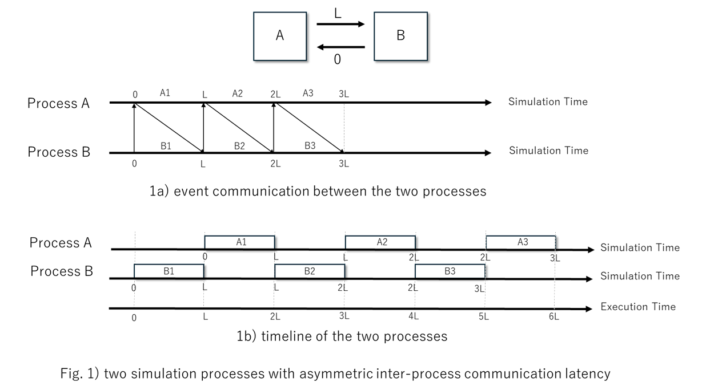
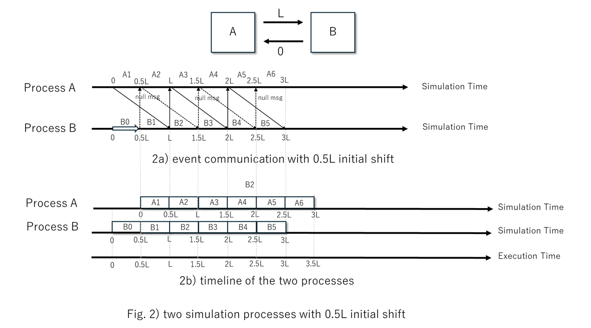

# 初期シフトを用いた並列離散イベント・シミュレーションの高速化

[English Version](./initial_shift_en.md)

## 設計課題

複数の論理プロセス（Logical Process）を並列実行する離散イベント・シミュレーションにおいて、シミュレーション速度の向上と実行精度の維持をいかに両立させるかが重要な設計課題となる。

シミュレーション速度を向上させるために、論理プロセスの並列実行を可能にするための条件は、並列実行する論理プロセス間でデータ依存性が存在しないことである。信号接続のない論理プロセス間はデータ依存性が存在せず、並列実行が容易であるが、信号接続のある論理プロセスをも並列実行することによってより高速な並列シミュレーションが可能となる。

## 解決アプローチ

本設計では、論理プロセス間の通信遅延に着目することによって、信号接続のある複数論理プロセスでも並列実行を可能にする手法を提供する。論理プロセス間のデータ通信は、CANなどシリアル通信を用いる場合に通信遅延が発生する。CANバスが空いている状態で、1 Mbpsの通信速度で8バイトの標準フレームを送信する場合に、おおむね約130〜140 µs程度の遅延が発生する。時刻Tにおいて論理プロセスAから論理プロセスBに向けて8バイトデータを送信した場合、時刻Tから時刻T+130µsの間、論理プロセスBが論理プロセスAからデータを受信することがないため、論理プロセスAからのデータ受信を待つことなく実行可能である。このように送信元のデータ送信タイミングとデータ通信遅延さえ決定すれば、因果律を違反しない論理プロセスの実行順序が導き出せる。

これを保守的プロトコル[1]で実装した結果が図1になる。プロセスAからBまでの通信には、通信遅延Lがかかるものとし、BからAまでは遅延がかからない非対称通信遅延を持つものとし、各論理プロセスは、走り出してから指定時刻までの実行を完了するまでイベントを出力せず、指定時刻までの実行を完了すると必ずイベントを出力するものとする。

各プロセスのシミュレーション時間軸の0時刻において、互いにイベントを送りあう。AからBへ送るイベントには、Lという通信遅延がかかるため、Lという時間の中で、Aからのイベントを受信することがなく、Bのシミュレーションを時間Lまですすめても安全である。しかし、BからAへ送るイベントは、通信遅延がかからないため、Aのシミュレーション時間を安全にすすめる目標時刻を与えることができない（図1a）。その結果、BだけL時間シミュレーションを進めることができるが、Aは0時刻にとどまらざるを得ない。BのL時間実行が終了すると、Aに向けてイベントを出力し、Aの0時刻からL時刻の間、Bからイベントを受信することがないことを保証する。その結果、AがL時間だけシミュレーション時間を進めることができる。実行時間がシミュレーション時間と完全比例と仮定すれば、AとBのタイムラインは図1bによって与えられ、プロセスAとプロセスBの時刻0から時刻3Lをシミュレーションするのに、実時間6Lを要する。

このようにして決定した論理プロセスの実行順序は、因果律を違反しないため、正確であるが、プロセスが逐次実行されるため、シミュレーション速度が低い問題がある。

これを解決するため、本設計では、シミュレーション開始前に各論理プロセスの時間軸をあらかじめずらして実行する**「初期シフト（Initial Shift）」と、実行中の同期を維持する「nullメッセージ」[2]**を組み合わせた手法を採用する。

- 初期シフト量の決定

プロセス間のタイムラグ L_AB（A→B）と L_BA（B→A）に差がある場合、その差の半分((L_BA - L_AB)/2)を初期シフト量として設定するのが最適である。これにより、両方向の通信待ち時間が均等化され、シミュレーション全体の実行時間が短縮される。

図2は、非対称通信遅延を持つ二つのシミュレーションプロセスを例として示す。AからBの通信はLとなるタイムラグを持つのに対して、BからAの通信ラグは0である。時刻0からシミュレーションをスタートさせた場合、時刻LまでプロセスBはイベントを受けることがないため、プロセスBは時刻Lまで先行実行することが可能である。ここで0.5LまでプロセスBを先行実行させたものとして、Bのシミュレーション時間の時刻0.5Lにおいて、先行実行が終了し、Aは時刻0から時刻0.5Lまではイベントを受け取る可能性がないため、Aに向けて時刻0.5Lまで実行可能であることを示すnullメッセージを送信する（図a）。その結果、実行時間の時刻0.5LからAの実行が可能となり、その結果、A実行のスタート時点においてBに向けて時刻Lまでシミュレーションするためのイベントが発行され、実行時間の時刻0.5Lから時刻Lまでは、AとBの並列実行することになる。時刻Lにおいて、BからAに向けてLまで実行可能であることを示すイベントと、AからBに向けて3L/2まで実行可能であることを示すnullメッセージが発行され、AとBの並列実行が都合よく継続することになる。

このように、プロセスBを0.5Lの時間だけ先行実行させた場合、AとBのシミュレーション時間をそれぞれ3Lだけ進めるためには、実行時間3.5Lしかかからない・

- 連立方程式による全体最適化

複数の論理プロセスが複雑に接続されているシステムでは、個々のパスごとのシフト量が相互に影響し合う。そのため、システム全体の接続関係を連立一次方程式として定式化し、全てのプロセスにおいて矛盾が生じない初期シフト量を一括で算出する。

## 制約およびトレードオフ

本設計は、論理プロセス間の接続関係とタイムラグがあらかじめ既知であることを前提としている。そのため、実行中に動的に接続トポロジが変化するようなシミュレーションには適さない。

一方で、自動車のECU（電子制御ユニット）とプラントモデルを組み合わせたHILS（Hardware-in-the-Loop Simulation）のように、構成が固定され、通信遅延（CANバス等）が明確なシステムにおいては、精度を犠牲にすることなく劇的な高速化が可能となる。

## 追記

本設計手法は、日本アイ・ビー・エム株式会社によって開発された技術であり、大規模な制御システムのシミュレーションにおいて、マルチコアプロセッサのリソースを最大限に引き出すためのコア・アルゴリズムとして位置付けられている。

特に、1ms未満の高速な制御ループを要するモータ制御等のシミュレーションにおいて、プロセス間の通信遅延によるボトルネックを解消する極めて有効な手段である。

## 参考文献
- [1] Alois Ferscha, Stish K. Tripathi, "Parallel and Distributed Simulation of Discrete Event Systems", the University of Maryland Computer Science Department; CS-TR-3336, 15-Oct-1998
- [2] Vikas Jha, Rajive Bagrodia, "Simultaneous events and lookahead in simulation protocols", Journal ACM Transactions on Modeling and Computer Simulation, Volume 10 Issue 3, July 2000

***

- [<-日本語版メモの索引](../README_JP.md)
- [<-英語版メモの索引](../README.md)